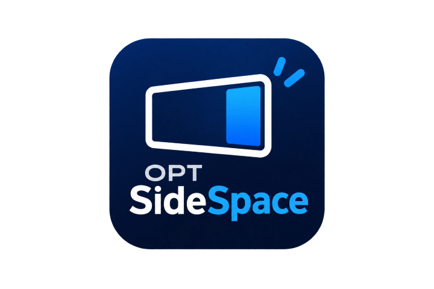

<div align="center">



# OPT SideSpace

**A lightweight, permanent right-side reserved workspace for Windows.**

[-0078D6?logo=windows)](https://github.com/mizanfinds/opt-sidespace/releases)
[](https://github.com/mizanfinds/opt-sidespace/releases/latest)
[](https://github.com/mizanfinds/opt-sidespace/releases/latest)
[](LICENSE)
[](#privacy--security)

*Tagline:* **Built to simplify**  
*Product Line:* **[OPT asia](https://opt.asia)**  
*Creator & Curator:* **[Mizan Finds](https://mizanfinds.com)**

---

### [⬇️ Download Latest Version (OPTSideSpace.exe)](https://github.com/mizanfinds/opt-sidespace/releases/latest)
*Standalone portable executable (~245 KB) — No installer or admin rights required!*

</div>

---

## 🎯 What is OPT SideSpace?

When you work on Windows, maximizing a window takes over your entire monitor. If you keep reference windows open (like ChatGPT, documentation, Microsoft Edge, or File Explorer), they constantly get covered or minimized.

**OPT SideSpace solves this natively.** It uses the genuine Windows Shell AppBar API (`SHAppBarMessage`) to permanently reserve a vertical column on the **RIGHT** edge of your primary monitor (400px default, customizable from 250px to 500px).

Your monitor is cleanly divided into two separate working zones:

```
┌───────────────────────────────────────────────┬────────────────────────────┐
│                                               │ [OPT] SideSpace        [✕] │
│                                               ├────────────────────────────┤
│           LEFT: MAIN DESKTOP AREA             │   RIGHT: RESERVED SPACE    │
│                                               │                            │
│  • Chrome, Photoshop, CapCut, Word, Excel     │  • ChatGPT, Edge, Explorer │
│  • All ordinary apps run normally             │  • Always stays docked     │
│  • Windows maximize ONLY within this left area│  • Never gets covered      │
│  • Never overlaps or covers SideSpace         │  • Switch apps anytime     │
│                                               │                            │
└───────────────────────────────────────────────┴────────────────────────────┘
```

---

## ✨ Key Features

- **Genuine Shell AppBar Reservation:** Maximized desktop windows automatically respect the boundary. They never cover SideSpace.
- **Universal Application Support:** Dock any running window or launch any installed Start Menu app (Edge, Chrome, ChatGPT, Notepad, File Explorer, etc.).
- **Zero-Flicker & No Focus Stealing:** Type peacefully in your main desktop windows; SideSpace stays docked without stealing your active focus.
- **Adjustable Width:** 250px, 300px, 350px, 400px, 450px, 500px, or custom pixel width.
- **One-Click Instant Release:** Closing SideSpace (`✕` or System Tray Exit) immediately releases 100% of the screen back to full monitor width.
- **Ultra-Lightweight & Portable:** Written in native C# / Win32. Zero external dependencies, no Electron, no WebView2 bloat, no background services.
- **System Tray Integration:** Runs quietly in the notification area with easy access to quick settings, switching apps, and width control.

---

## 🚀 How to Run

1. Download **[`OPTSideSpace.exe`](https://github.com/mizanfinds/opt-sidespace/releases/latest)**.
2. Double-click to run. No installation or administrator privileges required.
3. Choose an app from the quick buttons, click **Select App (⊞)** to pick any running or installed application, or drag any window to your SideSpace.
4. To exit or close, click the **[ ✕ ]** button at the top-right corner or right-click the tray icon and select **Exit**.

---

## 🔒 Privacy & Security

- **100% Offline:** Does not require an internet connection.
- **Zero Telemetry:** We do not track, log, or send any analytics, keystrokes, or screen data.
- **Portable & Clean:** Leaves no background services or system drivers. Settings are saved in your standard `%LOCALAPPDATA%\OPTSideSpace\config.json`.

---

## 🛡️ File Authenticity (SHA-256 Checksum)

To verify the integrity of your downloaded `OPTSideSpace.exe`:

```powershell
Get-FileHash OPTSideSpace.exe -Algorithm SHA256
```

**Official Release v1.0.0 SHA-256:**
`D5844BEA64D5B652E9EF463F5646CAF94DFF6C4BF395F7FDB6E62CF863BD147A`

---

## 🏢 About & Brand Links

- **Creator:** Mizan Finds — [mizanfinds.com](https://mizanfinds.com)
- **Product Studio:** OPT asia — [opt.asia](https://opt.asia)
- **Support & Issues:** [GitHub Issues](https://github.com/mizanfinds/opt-sidespace/issues)
- **License:** Freeware End-User License Agreement — see [LICENSE](LICENSE).

---
<div align="center">
Copyright © 2026 <b>Mizan Finds</b> & <b>OPT asia</b>. All rights reserved.
</div>

